<!-- AUTO-GENERATED by scripts/gen_readme.py - edit that script, not this file -->

# Aitachi-Hands — オープンソース17自由度デキスタラスハンドとPPO改良法の制御比較研究

**Aitachi-Hands** は CC-BY-4.0 の [ORCA Hand v2](https://github.com/orcahand)（17自由度・腱駆動）を本体とし、実測された Feetech HLS サーボ校正、安全保護付きシリアルプロトコル、MuJoCo / Isaac Lab シミュレーション、そして制御された強化学習比較を一つのリポジトリで提供します。

言語：[English](README.md) | [中文](README.zh.md) | **日本語** | [한국어](README.ko.md)

## 結果 (82 runs)

### タスク1 · 自由姿勢（5指・自己衝突なし）
| 手法 | シード | 成功率 ±σ | 時間 (s) | 貫通 (mm) | 報酬AUC | 学習時間 (分) |
|---|---|---|---|---|---|---|
| PPO | 3 | 1.000±0.000 | 0.31 | 0.02 | 0.50 | 6 |
| TRPO | 3 | 0.000±0.000 | -- | 0.03 | 0.76 | 37 |
| PPO-KL ⭐ | 5 | 1.000±0.000 | 0.26 | 0.00 | 0.58 | 17 |
| TD3 | 3 | 0.333±0.471 | 0.37 | 0.09 | 0.71 | 42 |
| SAC | 3 | 0.960±0.033 | 0.37 | 0.01 | 0.67 | 136 |
| TR-PPO-RB | 5 | 1.000±0.000 | 0.26 | 0.00 | 0.58 | 6 |
| ESPO | 5 | 1.000±0.000 | 0.26 | 0.00 | 0.44 | 8 |
| PPG | 3 | 1.000±0.000 | 0.26 | 0.01 | 0.55 | 7 |
| ExO-PPO | 5 | 1.000±0.000 | 0.26 | 0.00 | 0.58 | 8 |
| PBRS+PPO | 3 | 1.000±0.000 | 0.30 | 0.01 | 0.46 | 12 |
| RND+PPO | 3 | 0.000±0.000 | -- | 0.18 | 0.91 | 53 |
*最良（成功率→時間）: **PPO-KL***

### タスク2 · V → OK → OPEN 高速ジェスチャー連鎖
| 手法 | シード | 成功率 ±σ | 時間 (s) | 貫通 (mm) | 報酬AUC | 学習時間 (分) |
|---|---|---|---|---|---|---|
| PPO | 3 | 1.000±0.000 | 1.16 | 0.58 | 0.54 | 8 |
| TRPO | 3 | 0.000±0.000 | -- | 0.06 | 0.80 | 33 |
| PPO-KL ⭐ | 5 | 1.000±0.000 | 1.02 | 0.75 | 0.57 | 12 |
| TD3 | 3 | 1.000±0.000 | 2.30 | 1.88 | 0.96 | 84 |
| SAC | 3 | 0.000±0.000 | -- | 0.37 | 0.56 | 86 |
| TR-PPO-RB | 5 | 1.000±0.000 | 1.02 | 0.75 | 0.57 | 8 |
| ESPO | 5 | 1.000±0.000 | 1.02 | 0.75 | 0.34 | 8 |
| PPG | 3 | 1.000±0.000 | 1.03 | 0.71 | 0.54 | 7 |
| ExO-PPO | 5 | 1.000±0.000 | 1.02 | 0.75 | 0.57 | 9 |
| PBRS+PPO | 3 | 1.000±0.000 | 1.14 | 0.56 | 0.54 | 11 |
| RND+PPO | 3 | 0.000±0.000 | -- | 1.07 | 0.91 | 48 |
*最良（成功率→時間）: **PPO-KL***

### Optimizer Diagnostics (PPO family, Task 2 training tail)

| 手法 | clip frac | approx KL | max ratio | ESPO stop% | PPG aux KL |
|---|---|---|---|---|---|
| PPO | -- | -- | -- | -- | -- |
| TRPO | -- | -- | -- | -- | -- |
| PPO-KL | 0.4151 | 13.2887 | 96216.21 | 0.00 | -- |
| TR-PPO-RB | 0.4151 | 13.2887 | 96216.21 | 0.00 | -- |
| ESPO | 0.0405 | 0.3063 | 2584.80 | 0.59 | -- |
| PPG | 0.0002 | 0.0003 | 103.89 | 0.00 | -0.0115 |
| ExO-PPO | 0.4151 | 13.2887 | 96216.21 | 0.00 | -- |
| PBRS+PPO | -- | -- | -- | -- | -- |
| RND+PPO | -- | -- | -- | -- | -- |

### Sample Efficiency & Wall Clock

| 手法 | free: steps→90% | free AUC | free wall | seq: steps→90% | seq AUC | seq wall |
|---|---|---|---|---|---|---|
| PPO | 120k | 0.50 | 6m | 136k | 0.54 | 8m |
| TRPO | 75k | 0.76 | 37m | 85k | 0.80 | 33m |
| PPO-KL | 7k | 0.58 | 17m | 16k | 0.57 | 12m |
| TD3 | 13k | 0.71 | 42m | 20k | 0.96 | 84m |
| SAC | 101k | 0.67 | 136m | 133k | 0.56 | 86m |
| TR-PPO-RB | 7k | 0.58 | 6m | 16k | 0.57 | 8m |
| ESPO | 7k | 0.44 | 8m | 16k | 0.34 | 8m |
| PPG | 85k | 0.55 | 7m | 35k | 0.54 | 7m |
| ExO-PPO | 7k | 0.58 | 8m | 16k | 0.57 | 9m |
| PBRS+PPO | 120k | 0.46 | 12m | 136k | 0.54 | 11m |
| RND+PPO | 20k | 0.91 | 53m | 28k | 0.91 | 48m |

### Task-2 Phase Decomposition (successful episodes)

| 手法 | V (s) | OK (s) | OPEN (s) | total (s) |
|---|---|---|---|---|
| PPO | 0.43 | 0.41 | 0.31 | 1.16 |
| PPO-KL | 0.36 | 0.36 | 0.30 | 1.02 |
| TD3 | 0.51 | 0.40 | 1.39 | 2.30 |
| TR-PPO-RB | 0.36 | 0.36 | 0.30 | 1.02 |
| ESPO | 0.36 | 0.36 | 0.30 | 1.02 |
| PPG | 0.37 | 0.36 | 0.30 | 1.03 |
| ExO-PPO | 0.36 | 0.36 | 0.30 | 1.02 |
| PBRS+PPO | 0.42 | 0.41 | 0.31 | 1.14 |

### Comparison Figures (13)

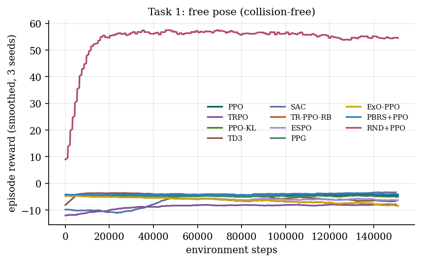
*Task 1 learning curves (smoothed episode reward, 3 seeds)*

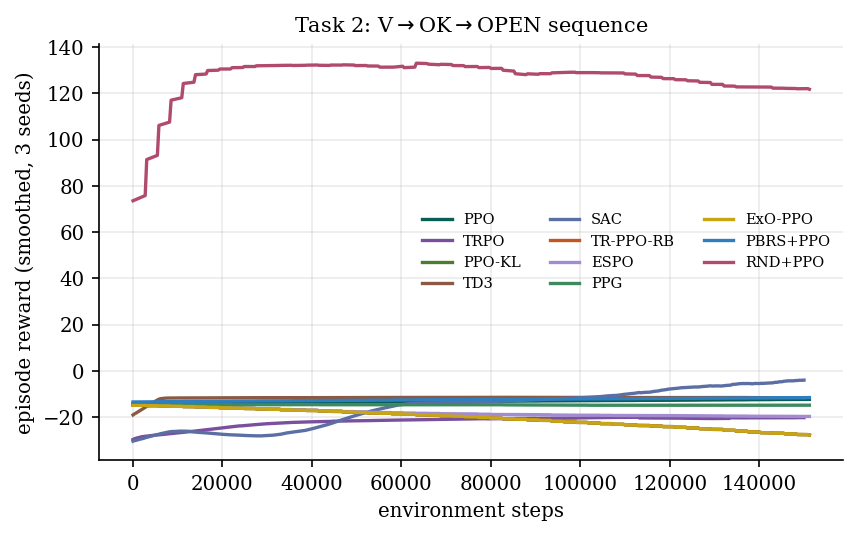
*Task 2 learning curves*

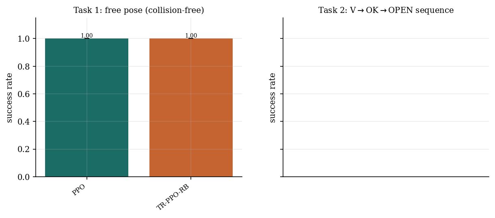
*Final success rate (deterministic 25-seed eval, mean±σ)*

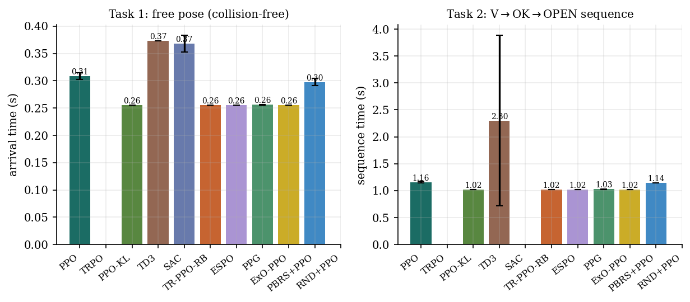
*Arrival / sequence time*

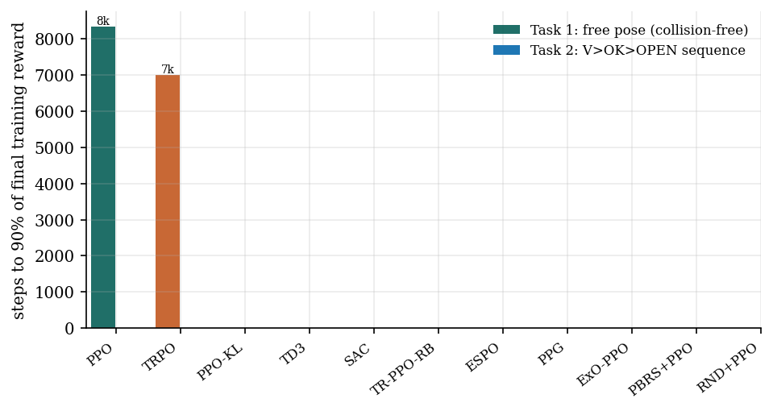
*Sample efficiency: steps to 90% of final training reward*

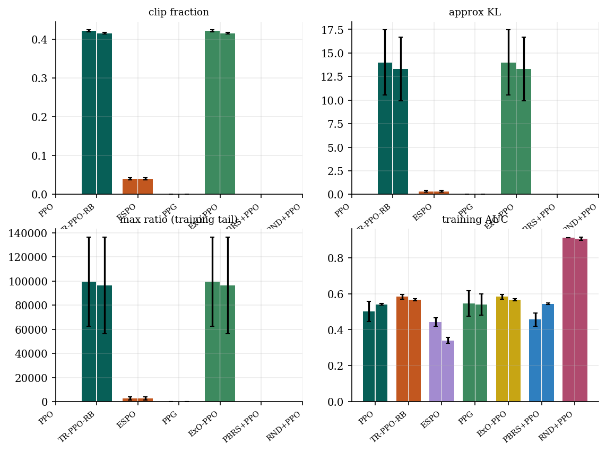
*PPO-family optimizer diagnostics (clip/KL/ratio/AUC)*

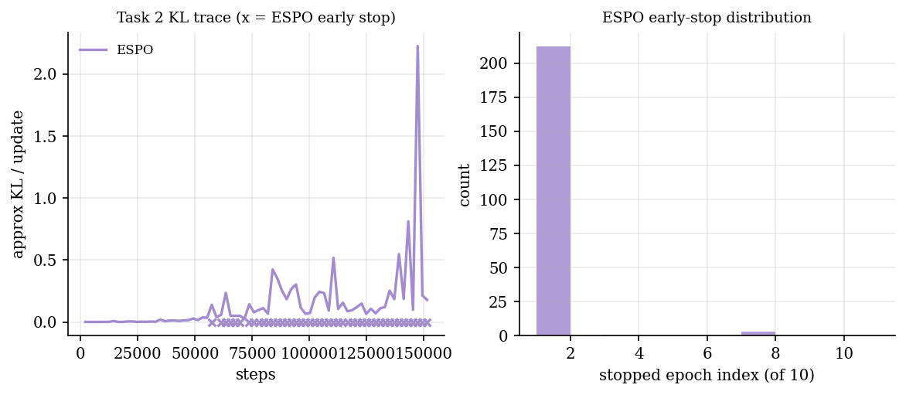
*ESPO early stopping: KL trace + stop-epoch histogram*

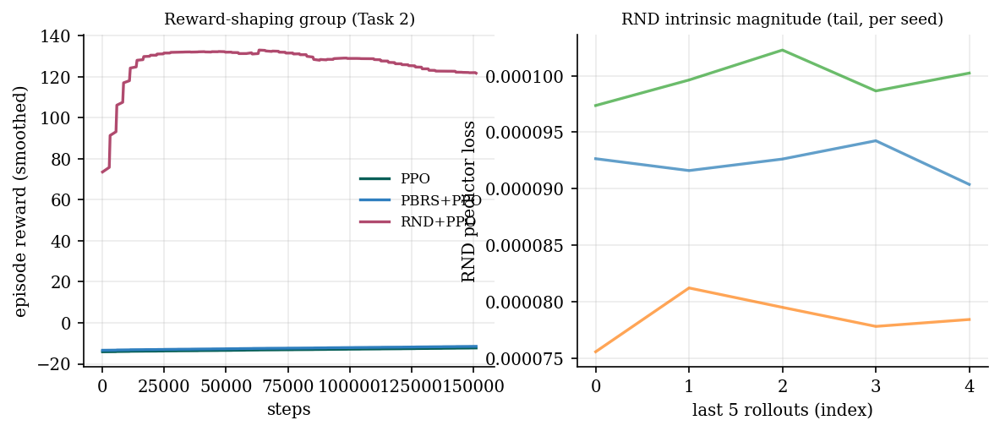
*Reward-shaping group (PBRS/RND vs PPO) + RND intrinsic tail*

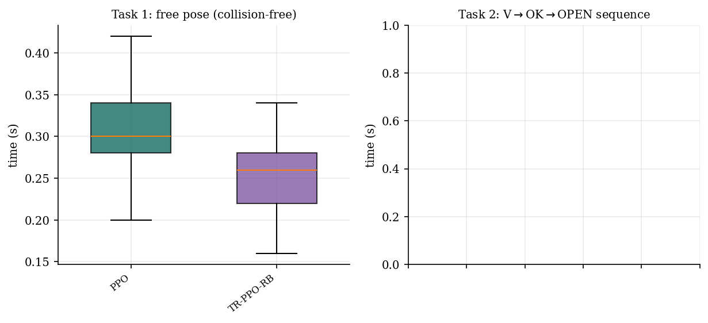
*Evaluation time distributions (box plots)*

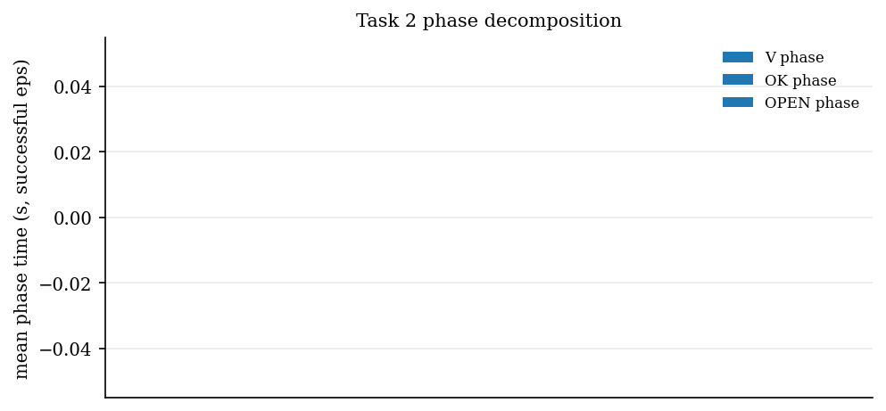
*Task-2 per-phase time decomposition (V/OK/OPEN)*

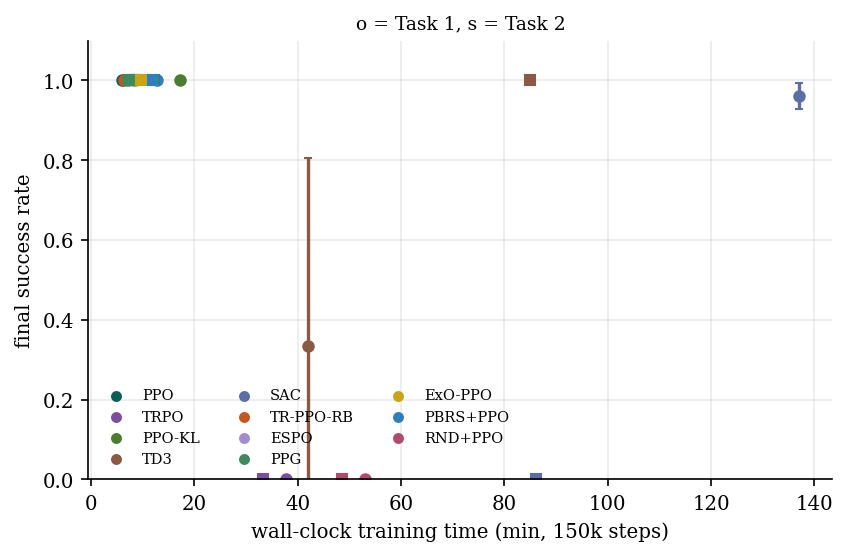
*Wall-clock efficiency: final success vs training time*

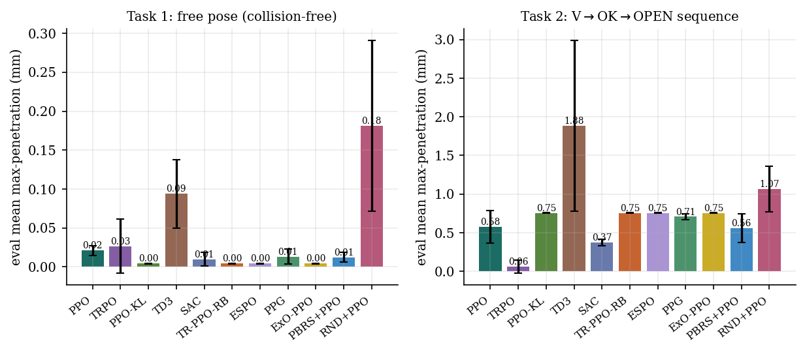
*Safety proxy: max self-penetration during evaluation*

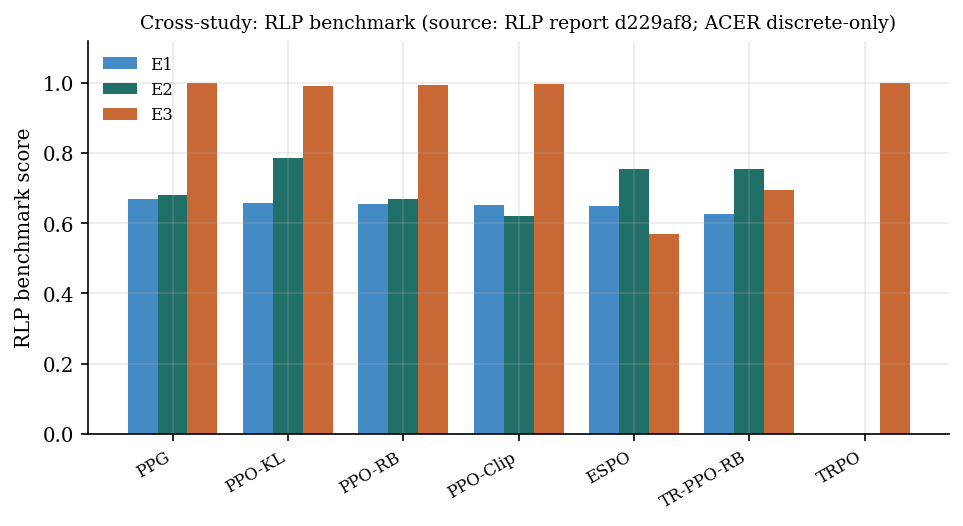
*Cross-study comparison (RLP benchmark, static data)*

## 実験プロトコル
- **行列**: 2タスク × 11手法 × 3シード = 66実行、各150,000環境ステップ。
- **共通バックボーン**: 残差アクション `cmd = prior + 0.3·π(s)`（0.15 rad/サイクル速度制限）。
- **ネットワーク**: 全手法 256×256（PPG は共有トランク）。
- **評価**: 決定論的ポリシー、25固定シード（7001–7025）。
- **スタック**: MuJoCo 3.3.7 · torch 2.11.0+cu130 · SB3 2.9.2 · RTX 3070 Laptop。

## 原論文からの相違（開示）
1. **TR-PPO-RB**: 状態ごとのKLを |log ρ|>0.5 で代理。c=1.5。
2. **RND**: 単一価値ヘッド簡略版、重み0.5。
3. **ExO-PPO**: ε·tanh 軟飽和による平滑圧縮。
4. **OPPO**: 引用のみ（LLMサービス論文のため実行せず）。
5. PBRS はタイムアウト終端でポテンシャル補正なし。
6. **TD3/SAC**: 4ステップごとに4更新（UTD 1:1 は原論文同様）。

### Negative-Result Attribution (7-run follow-up)

| Evidence | Result | Verdict |
|---|---|---|
| TRPO drift (default init, 10k-500k, 2 seeds free + seq) | 0.000 at every checkpoint | budget & slow-drift hypotheses refuted |
| TRPO 500k final (3.3x budget) | 0.000 free & seq | not a budget limitation |
| TRPO matched-init (log_std=-1.5) free | 0.80 @10k -> 0.36 -> 0.04 | exploration-scale mismatch destroys the prior; CG updates then erode it |
| TRPO matched-init seq | 0.000 at all checkpoints | structural failure under 3-phase hold criteria |
| RND lambda 0.5 vs 0.05 (both tasks) | 0.000 across the board | direction conflict (intrinsic novelty vs hold-window), not scale |
| RND CONTROL lambda=0 (both tasks) | **1.000 / 1.000** (0.30s / 1.14s) | wrapper & backend harmless; dose-response isolates the intrinsic signal |
| TRPO matched-init, 3 seeds (free) | 10k: {0.80, 1.00, 0.84} -> 150k: {0.04, 0.40, 0.52} | triple-seed replication of rescue-then-erode |
| seq SAC entropy ablation (-16 -> -4) | 0.000 | structural: not an entropy-scale effect; off-policy bootstrapping vs 3-phase criteria |


**Verdict**: TRPO's failure is a two-stage mismatch - (1) default exploration scale (log_std_init=0, 4.7x the PPO family's) destroys the solvable residual prior within 10k steps and never recovers; (2) even with matched init on Task 1, conservative CG+line-search updates erode a rescued 0.80 down to 0.04 - the zero-policy prior is near-optimal and TRPO's improvement steps actively hurt it. On Task 2 TRPO fails structurally regardless of init. RND's negative result is a direction conflict: the single-value-head simplification lets novelty reward fight the hold-window criteria at any weight. Full curves: fig14; data: hands-rl/results_attribution/.

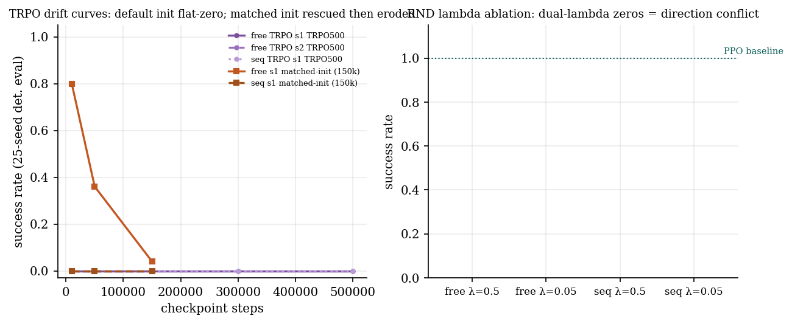

## 他研究との对照（RLP ベンチマーク）

| 手法 | E1 | E2 | E3 | 備考 |
|---|---|---|---|---|
| PPG | 0.669±0.02 | 0.681 | 1.000±0.00 |  |
| PPO-KL | 0.658 | 0.785 | 0.992 |  |
| PPO-RB | 0.655 | 0.669 | 0.995 |  |
| PPO-Clip | 0.652 | 0.620 | 0.996 | E2 种子散布 ±0.17 |
| ESPO | 0.648 | 0.755 | 0.568 |  |
| TR-PPO-RB | 0.625 | 0.754 | 0.694 |  |
| TRPO | -- | -- | 1.000 | E3=1.000 真值；CG+线搜开销 |
| ACER | -- | -- | -- | 离散动作对照（SB3 ACER 仅支持离散，详见 RLP 报告） |

*出典: Reinforcement-Learning-Policy 仓实验报告（11 页，d229af8）*

## クイックスタート
```bash
git clone https://github.com/aitachi/Aitachi-Hand && cd Aitachi-Hands
python scripts/fetch_assets.py          # 公式 orca_v2 モデル
bash scripts/smoke_all.sh               # 13パス スモークテスト(~4分)
bash scripts/run_matrix_all.sh          # 66実行の全行列(~6-8時間)
python scripts/aggregate.py             # results/summary.{csv,json}
python scripts/make_figures.py          # figures/fig01..fig12
```

> 111 MB の MuJoCo モデルはリポジトリ外 — `python scripts/fetch_assets.py` を実行（または `AHAND_MODEL_ROOT` を既存の orca_v2 に設定）。

## 限界
結果はシミュレーション範囲。実機展開には保護付き再生パイプラインが別途必要。単一予算の制御比較であり、手法別チューニングで順位は変わり得る。

## 成果物
- 📕 教科書（19ページPDF・中国語）: `textbook/main.pdf`
- 📄 IEEE論文: `paper/ieee_main.pdf`
- 📊 12枚の比較図: `figures/`
- 🧾 サーボ指令付録: 教科書付録A
- 🌐 プロジェクトサイト: http://115.190.62.87/Aitachi-Hand/

