<!-- AUTO-GENERATED by scripts/gen_readme.py - edit that script, not this file -->

# Aitachi-Hands — 오픈소스 17-자유도 로봇 손 플랫폼과 PPO 개선법 통제 비교 연구

**Aitachi-Hands**는 CC-BY-4.0 [ORCA Hand v2](https://github.com/orcahand)(17자유도, 텐던 구동) 본체에 실측된 Feetech HLS 서보 캘리브레이션, 안전 보호 직렬 프로토콜, MuJoCo / Isaac Lab 시뮬레이션, 그리고 통제된 강화학습 비교를 하나의 저장소로 제공합니다.

언어: [English](README.md) | [中文](README.zh.md) | [日本語](README.ja.md) | **한국어**

## 결과 (82 runs)

### 과제 1 · 자유 자세(5지, 자가충돌 없음)
| 방법 | 시드 | 성공률 ±σ | 시간 (s) | 관통 (mm) | 보상AUC | 학습시간 (분) |
|---|---|---|---|---|---|---|
| PPO | 3 | 1.000±0.000 | 0.31 | 0.02 | 0.50 | 6 |
| TRPO | 3 | 0.000±0.000 | -- | 0.03 | 0.76 | 37 |
| PPO-KL ⭐ | 5 | 1.000±0.000 | 0.26 | 0.00 | 0.58 | 17 |
| TD3 | 3 | 0.333±0.471 | 0.37 | 0.09 | 0.71 | 42 |
| SAC | 3 | 0.960±0.033 | 0.37 | 0.01 | 0.67 | 136 |
| TR-PPO-RB | 5 | 1.000±0.000 | 0.26 | 0.00 | 0.58 | 6 |
| ESPO | 5 | 1.000±0.000 | 0.26 | 0.00 | 0.44 | 8 |
| PPG | 3 | 1.000±0.000 | 0.26 | 0.01 | 0.55 | 7 |
| ExO-PPO | 5 | 1.000±0.000 | 0.26 | 0.00 | 0.58 | 8 |
| PBRS+PPO | 3 | 1.000±0.000 | 0.30 | 0.01 | 0.46 | 12 |
| RND+PPO | 3 | 0.000±0.000 | -- | 0.18 | 0.91 | 53 |
*최우수(성공률→시간): **PPO-KL***

### 과제 2 · V → OK → OPEN 빠른 제스처 연쇄
| 방법 | 시드 | 성공률 ±σ | 시간 (s) | 관통 (mm) | 보상AUC | 학습시간 (분) |
|---|---|---|---|---|---|---|
| PPO | 3 | 1.000±0.000 | 1.16 | 0.58 | 0.54 | 8 |
| TRPO | 3 | 0.000±0.000 | -- | 0.06 | 0.80 | 33 |
| PPO-KL ⭐ | 5 | 1.000±0.000 | 1.02 | 0.75 | 0.57 | 12 |
| TD3 | 3 | 1.000±0.000 | 2.30 | 1.88 | 0.96 | 84 |
| SAC | 3 | 0.000±0.000 | -- | 0.37 | 0.56 | 86 |
| TR-PPO-RB | 5 | 1.000±0.000 | 1.02 | 0.75 | 0.57 | 8 |
| ESPO | 5 | 1.000±0.000 | 1.02 | 0.75 | 0.34 | 8 |
| PPG | 3 | 1.000±0.000 | 1.03 | 0.71 | 0.54 | 7 |
| ExO-PPO | 5 | 1.000±0.000 | 1.02 | 0.75 | 0.57 | 9 |
| PBRS+PPO | 3 | 1.000±0.000 | 1.14 | 0.56 | 0.54 | 11 |
| RND+PPO | 3 | 0.000±0.000 | -- | 1.07 | 0.91 | 48 |
*최우수(성공률→시간): **PPO-KL***

### Optimizer Diagnostics (PPO family, Task 2 training tail)

| 방법 | clip frac | approx KL | max ratio | ESPO stop% | PPG aux KL |
|---|---|---|---|---|---|
| PPO | -- | -- | -- | -- | -- |
| TRPO | -- | -- | -- | -- | -- |
| PPO-KL | 0.4151 | 13.2887 | 96216.21 | 0.00 | -- |
| TR-PPO-RB | 0.4151 | 13.2887 | 96216.21 | 0.00 | -- |
| ESPO | 0.0405 | 0.3063 | 2584.80 | 0.59 | -- |
| PPG | 0.0002 | 0.0003 | 103.89 | 0.00 | -0.0115 |
| ExO-PPO | 0.4151 | 13.2887 | 96216.21 | 0.00 | -- |
| PBRS+PPO | -- | -- | -- | -- | -- |
| RND+PPO | -- | -- | -- | -- | -- |

### Sample Efficiency & Wall Clock

| 방법 | free: steps→90% | free AUC | free wall | seq: steps→90% | seq AUC | seq wall |
|---|---|---|---|---|---|---|
| PPO | 120k | 0.50 | 6m | 136k | 0.54 | 8m |
| TRPO | 75k | 0.76 | 37m | 85k | 0.80 | 33m |
| PPO-KL | 7k | 0.58 | 17m | 16k | 0.57 | 12m |
| TD3 | 13k | 0.71 | 42m | 20k | 0.96 | 84m |
| SAC | 101k | 0.67 | 136m | 133k | 0.56 | 86m |
| TR-PPO-RB | 7k | 0.58 | 6m | 16k | 0.57 | 8m |
| ESPO | 7k | 0.44 | 8m | 16k | 0.34 | 8m |
| PPG | 85k | 0.55 | 7m | 35k | 0.54 | 7m |
| ExO-PPO | 7k | 0.58 | 8m | 16k | 0.57 | 9m |
| PBRS+PPO | 120k | 0.46 | 12m | 136k | 0.54 | 11m |
| RND+PPO | 20k | 0.91 | 53m | 28k | 0.91 | 48m |

### Task-2 Phase Decomposition (successful episodes)

| 방법 | V (s) | OK (s) | OPEN (s) | total (s) |
|---|---|---|---|---|
| PPO | 0.43 | 0.41 | 0.31 | 1.16 |
| PPO-KL | 0.36 | 0.36 | 0.30 | 1.02 |
| TD3 | 0.51 | 0.40 | 1.39 | 2.30 |
| TR-PPO-RB | 0.36 | 0.36 | 0.30 | 1.02 |
| ESPO | 0.36 | 0.36 | 0.30 | 1.02 |
| PPG | 0.37 | 0.36 | 0.30 | 1.03 |
| ExO-PPO | 0.36 | 0.36 | 0.30 | 1.02 |
| PBRS+PPO | 0.42 | 0.41 | 0.31 | 1.14 |

### Comparison Figures (13)

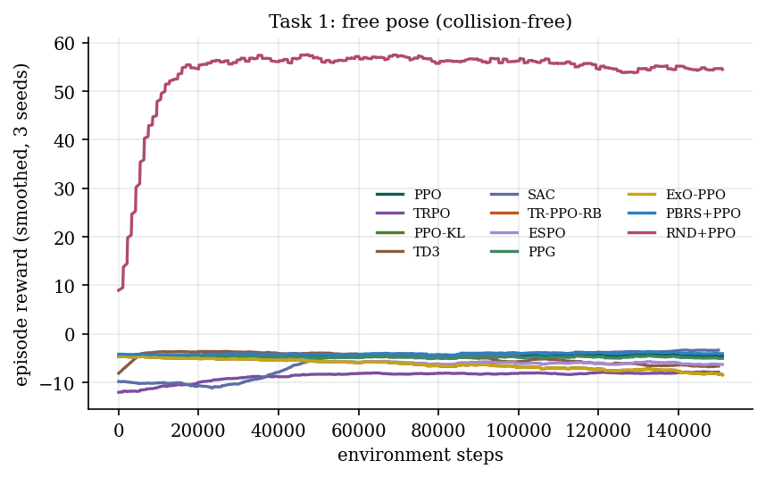
*Task 1 learning curves (smoothed episode reward, 3 seeds)*

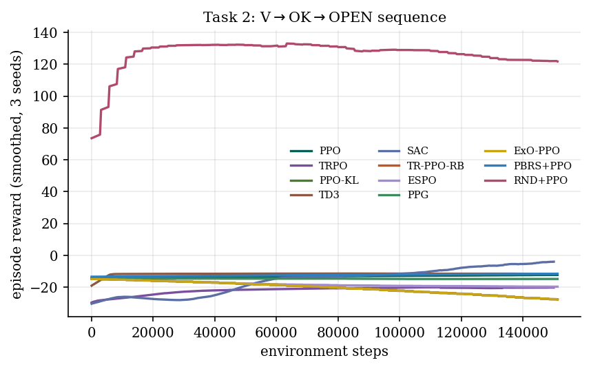
*Task 2 learning curves*

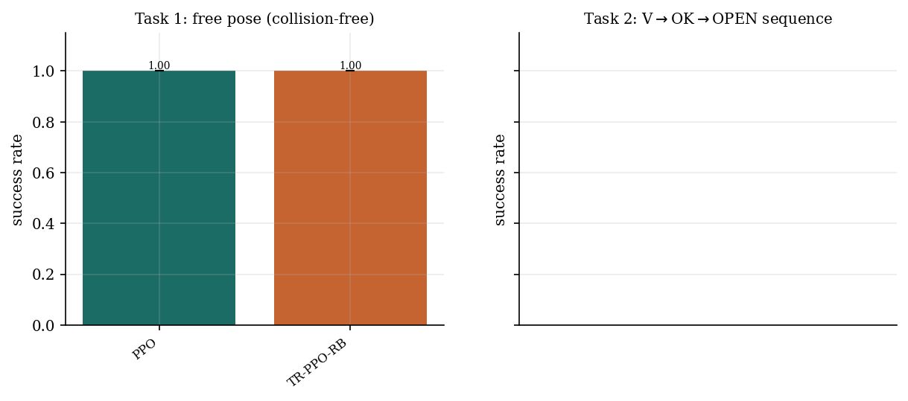
*Final success rate (deterministic 25-seed eval, mean±σ)*

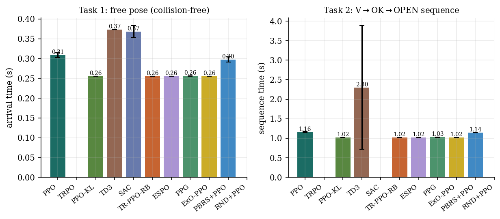
*Arrival / sequence time*

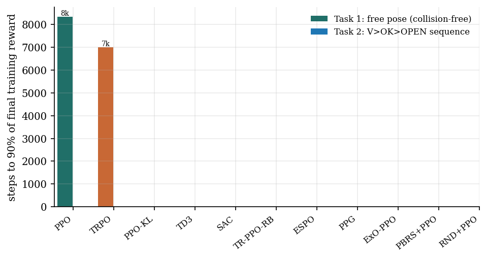
*Sample efficiency: steps to 90% of final training reward*

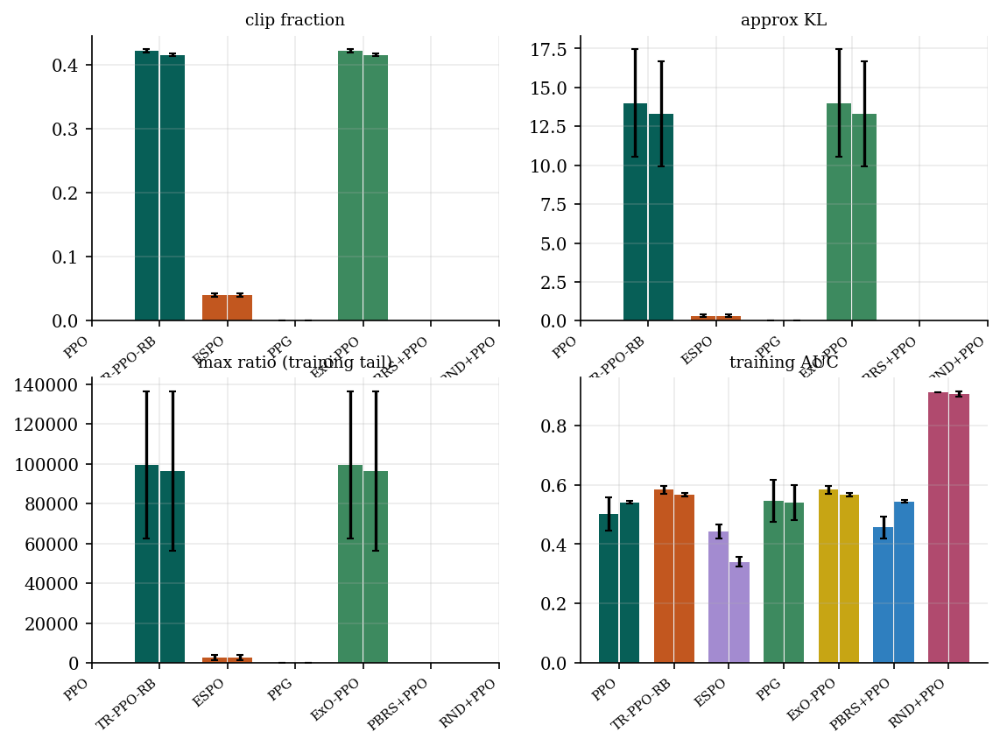
*PPO-family optimizer diagnostics (clip/KL/ratio/AUC)*

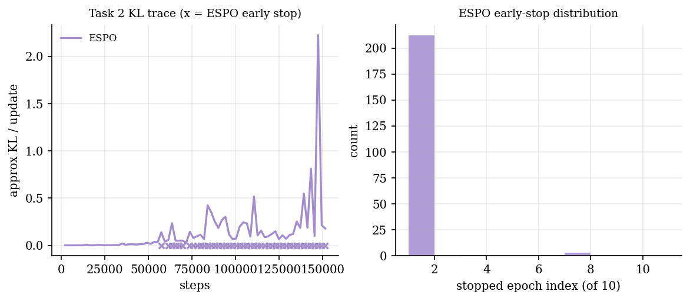
*ESPO early stopping: KL trace + stop-epoch histogram*

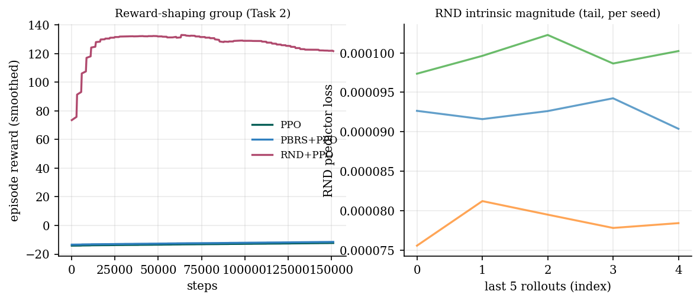
*Reward-shaping group (PBRS/RND vs PPO) + RND intrinsic tail*

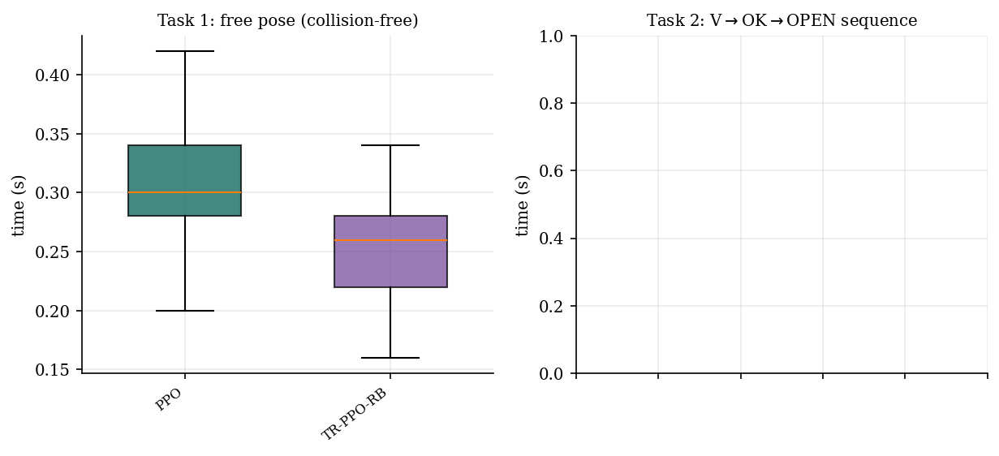
*Evaluation time distributions (box plots)*

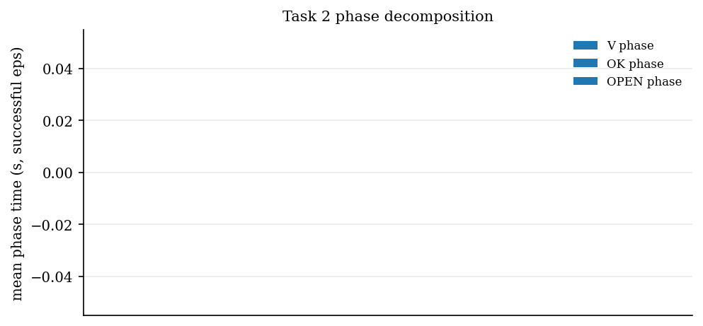
*Task-2 per-phase time decomposition (V/OK/OPEN)*

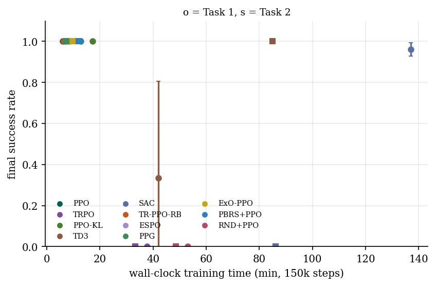
*Wall-clock efficiency: final success vs training time*

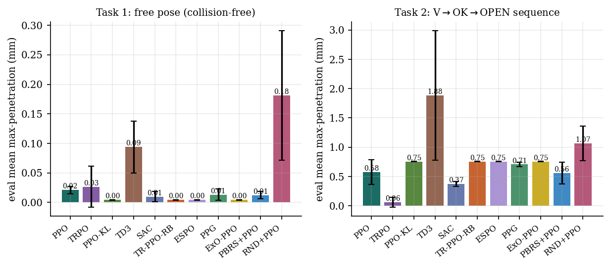
*Safety proxy: max self-penetration during evaluation*

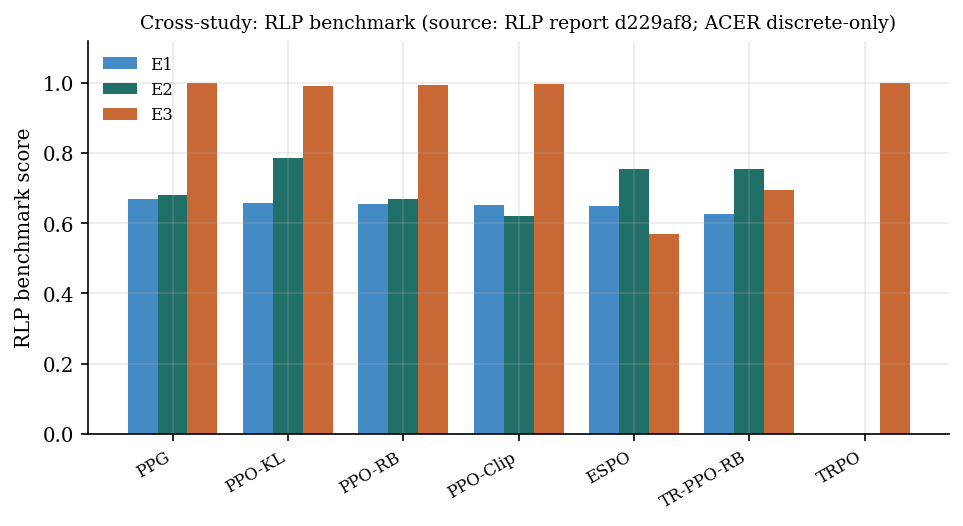
*Cross-study comparison (RLP benchmark, static data)*

## 실험 프로토콜
- **행렬**: 2과제 × 11방법 × 3시드 = 66실행, 각 150,000 환경 스텝.
- **공통 백본**: 잔차 행동 `cmd = prior + 0.3·π(s)`(주기당 0.15 rad 속도 제한).
- **네트워크**: 전 방법 256×256(PPG는 공유 트렁크).
- **평가**: 결정론 정책, 25 고정 시드(7001–7025).
- **스택**: MuJoCo 3.3.7 · torch 2.11.0+cu130 · SB3 2.9.2 · RTX 3070 Laptop.

## 원 논문과의 차이(공개)
1. **TR-PPO-RB**: 상태별 KL을 |log ρ|>0.5로 대리, c=1.5.
2. **RND**: 단일 가치 헤드 간소화, 가중치 0.5.
3. **ExO-PPO**: ε·tanh 연화 포화로 평활 압축.
4. **OPPO**: 인용만(LLM 서빙 시스템 논문).
5. PBRS 타임아웃 종단 전위 보정 없음.
6. **TD3/SAC**: 4스텝당 4더 업데이트(UTD 1:1 동일).

### Negative-Result Attribution (7-run follow-up)

| Evidence | Result | Verdict |
|---|---|---|
| TRPO drift (default init, 10k-500k, 2 seeds free + seq) | 0.000 at every checkpoint | budget & slow-drift hypotheses refuted |
| TRPO 500k final (3.3x budget) | 0.000 free & seq | not a budget limitation |
| TRPO matched-init (log_std=-1.5) free | 0.80 @10k -> 0.36 -> 0.04 | exploration-scale mismatch destroys the prior; CG updates then erode it |
| TRPO matched-init seq | 0.000 at all checkpoints | structural failure under 3-phase hold criteria |
| RND lambda 0.5 vs 0.05 (both tasks) | 0.000 across the board | direction conflict (intrinsic novelty vs hold-window), not scale |
| RND CONTROL lambda=0 (both tasks) | **1.000 / 1.000** (0.30s / 1.14s) | wrapper & backend harmless; dose-response isolates the intrinsic signal |
| TRPO matched-init, 3 seeds (free) | 10k: {0.80, 1.00, 0.84} -> 150k: {0.04, 0.40, 0.52} | triple-seed replication of rescue-then-erode |
| seq SAC entropy ablation (-16 -> -4) | 0.000 | structural: not an entropy-scale effect; off-policy bootstrapping vs 3-phase criteria |


**Verdict**: TRPO's failure is a two-stage mismatch - (1) default exploration scale (log_std_init=0, 4.7x the PPO family's) destroys the solvable residual prior within 10k steps and never recovers; (2) even with matched init on Task 1, conservative CG+line-search updates erode a rescued 0.80 down to 0.04 - the zero-policy prior is near-optimal and TRPO's improvement steps actively hurt it. On Task 2 TRPO fails structurally regardless of init. RND's negative result is a direction conflict: the single-value-head simplification lets novelty reward fight the hold-window criteria at any weight. Full curves: fig14; data: hands-rl/results_attribution/.

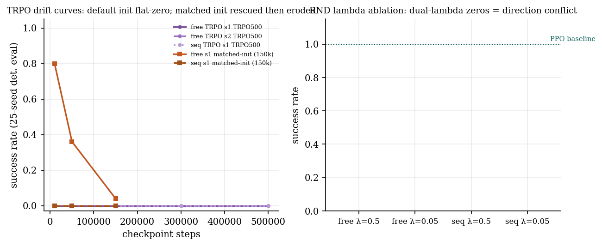

## 교차 연구 대조(RLP 벤치마크)

| 방법 | E1 | E2 | E3 | 비고 |
|---|---|---|---|---|
| PPG | 0.669±0.02 | 0.681 | 1.000±0.00 |  |
| PPO-KL | 0.658 | 0.785 | 0.992 |  |
| PPO-RB | 0.655 | 0.669 | 0.995 |  |
| PPO-Clip | 0.652 | 0.620 | 0.996 | E2 种子散布 ±0.17 |
| ESPO | 0.648 | 0.755 | 0.568 |  |
| TR-PPO-RB | 0.625 | 0.754 | 0.694 |  |
| TRPO | -- | -- | 1.000 | E3=1.000 真值；CG+线搜开销 |
| ACER | -- | -- | -- | 离散动作对照（SB3 ACER 仅支持离散，详见 RLP 报告） |

*출처: Reinforcement-Learning-Policy 仓实验报告（11 页，d229af8）*

## 빠른 시작
```bash
git clone https://github.com/aitachi/Aitachi-Hand && cd Aitachi-Hands
python scripts/fetch_assets.py          # 공식 orca_v2 모델
bash scripts/smoke_all.sh               # 13경로 스모크(~4분)
bash scripts/run_matrix_all.sh          # 66실행 전체 매트릭스(~6-8시간)
python scripts/aggregate.py             # results/summary.{csv,json}
python scripts/make_figures.py          # figures/fig01..fig12
```

> 111 MB MuJoCo 모델은 저장소에 포함되지 않음 — `python scripts/fetch_assets.py` 실행(또는 `AHAND_MODEL_ROOT`를 기존 orca_v2로 설정).

## 한계
결과는 시뮬레이션 범위. 실기기 배포에는 보호된 재생 파이프라인이 별도로 필요. 단일 예산의 통제 비교이며 방법별 튜닝으로 순위는 변할 수 있음.

## 산출물
- 📕 교재(19쪽 PDF, 중국어): `textbook/main.pdf`
- 📄 IEEE 논문: `paper/ieee_main.pdf`
- 📊 12장 비교 그림: `figures/`
- 🧾 서보 명령 부록: 교재 부록A
- 🌐 프로젝트 사이트: http://115.190.62.87/Aitachi-Hand/

