<!-- AUTO-GENERATED by scripts/gen_readme.py - edit that script, not this file -->

# Aitachi-Hands — Open 17-DOF Dexterous-Hand Platform & PPO-Improvement Controlled Study

**Aitachi-Hands** couples the CC-BY-4.0 [ORCA Hand v2](https://github.com/orcahand) (17 DOF, tendon-driven) with measured Feetech-HLS servo calibration, a safety-gated serial protocol, MuJoCo/Isaac-Lab simulation, and a controlled reinforcement-learning comparison — everything from one repository.

Language: **English** | [中文](README.zh.md) | [日本語](README.ja.md) | [한국어](README.ko.md)

## Results (66 runs)

### Task 1 · Collision-free free posing (5 fingers, no self-fighting)
| Method | Seeds | Success ±σ | Time (s) | Pen. (mm) | Reward AUC | Wall (min) |
|---|---|---|---|---|---|---|
| PPO | 3 | 1.000±0.000 | 0.31 | 0.02 | 0.50 | 6 |
| TRPO | 3 | 0.000±0.000 | -- | 0.03 | 0.76 | 37 |
| PPO-KL ⭐ | 3 | 1.000±0.000 | 0.26 | 0.00 | 0.58 | 26 |
| TD3 | 3 | 0.333±0.471 | 0.37 | 0.09 | 0.71 | 42 |
| SAC | 3 | 0.960±0.033 | 0.37 | 0.01 | 0.67 | 136 |
| TR-PPO-RB | 3 | 1.000±0.000 | 0.26 | 0.00 | 0.58 | 7 |
| ESPO | 3 | 1.000±0.000 | 0.26 | 0.00 | 0.43 | 11 |
| PPG | 3 | 1.000±0.000 | 0.26 | 0.01 | 0.55 | 7 |
| ExO-PPO | 3 | 1.000±0.000 | 0.26 | 0.00 | 0.58 | 11 |
| PBRS+PPO | 3 | 1.000±0.000 | 0.30 | 0.01 | 0.46 | 12 |
| RND+PPO | 3 | 0.000±0.000 | -- | 0.18 | 0.91 | 53 |
*Best (success, then time): **PPO-KL***

### Task 2 · Rapid gesture sequence V → OK → OPEN
| Method | Seeds | Success ±σ | Time (s) | Pen. (mm) | Reward AUC | Wall (min) |
|---|---|---|---|---|---|---|
| PPO | 3 | 1.000±0.000 | 1.16 | 0.58 | 0.54 | 8 |
| TRPO | 3 | 0.000±0.000 | -- | 0.06 | 0.80 | 33 |
| PPO-KL ⭐ | 3 | 1.000±0.000 | 1.02 | 0.75 | 0.57 | 16 |
| TD3 | 3 | 1.000±0.000 | 2.30 | 1.88 | 0.96 | 84 |
| SAC | 3 | 0.000±0.000 | -- | 0.37 | 0.56 | 86 |
| TR-PPO-RB | 3 | 1.000±0.000 | 1.02 | 0.75 | 0.57 | 8 |
| ESPO | 3 | 1.000±0.000 | 1.02 | 0.75 | 0.33 | 7 |
| PPG | 3 | 1.000±0.000 | 1.03 | 0.71 | 0.54 | 7 |
| ExO-PPO | 3 | 1.000±0.000 | 1.02 | 0.75 | 0.57 | 10 |
| PBRS+PPO | 3 | 1.000±0.000 | 1.14 | 0.56 | 0.54 | 11 |
| RND+PPO | 3 | 0.000±0.000 | -- | 1.07 | 0.91 | 48 |
*Best (success, then time): **PPO-KL***

### Optimizer Diagnostics (PPO family, Task 2 training tail)

| Method | clip frac | approx KL | max ratio | ESPO stop% | PPG aux KL |
|---|---|---|---|---|---|
| PPO | -- | -- | -- | -- | -- |
| TRPO | -- | -- | -- | -- | -- |
| PPO-KL | 0.4148 | 15.3896 | 94997.18 | 0.00 | -- |
| TR-PPO-RB | 0.4148 | 15.3896 | 94997.18 | 0.00 | -- |
| ESPO | 0.0384 | 0.3054 | 2858.82 | 0.60 | -- |
| PPG | 0.0002 | 0.0003 | 103.89 | 0.00 | -0.0115 |
| ExO-PPO | 0.4148 | 15.3896 | 94997.18 | 0.00 | -- |
| PBRS+PPO | -- | -- | -- | -- | -- |
| RND+PPO | -- | -- | -- | -- | -- |

### Sample Efficiency & Wall Clock

| Method | free: steps→90% | free AUC | free wall | seq: steps→90% | seq AUC | seq wall |
|---|---|---|---|---|---|---|
| PPO | 120k | 0.50 | 6m | 136k | 0.54 | 8m |
| TRPO | 75k | 0.76 | 37m | 85k | 0.80 | 33m |
| PPO-KL | 7k | 0.58 | 26m | 16k | 0.57 | 16m |
| TD3 | 13k | 0.71 | 42m | 20k | 0.96 | 84m |
| SAC | 101k | 0.67 | 136m | 133k | 0.56 | 86m |
| TR-PPO-RB | 7k | 0.58 | 7m | 16k | 0.57 | 8m |
| ESPO | 7k | 0.43 | 11m | 16k | 0.33 | 7m |
| PPG | 85k | 0.55 | 7m | 35k | 0.54 | 7m |
| ExO-PPO | 7k | 0.58 | 11m | 16k | 0.57 | 10m |
| PBRS+PPO | 120k | 0.46 | 12m | 136k | 0.54 | 11m |
| RND+PPO | 20k | 0.91 | 53m | 28k | 0.91 | 48m |

### Task-2 Phase Decomposition (successful episodes)

| Method | V (s) | OK (s) | OPEN (s) | total (s) |
|---|---|---|---|---|
| PPO | 0.43 | 0.41 | 0.31 | 1.16 |
| PPO-KL | 0.36 | 0.36 | 0.30 | 1.02 |
| TD3 | 0.51 | 0.40 | 1.39 | 2.30 |
| TR-PPO-RB | 0.36 | 0.36 | 0.30 | 1.02 |
| ESPO | 0.36 | 0.36 | 0.30 | 1.02 |
| PPG | 0.37 | 0.36 | 0.30 | 1.03 |
| ExO-PPO | 0.36 | 0.36 | 0.30 | 1.02 |
| PBRS+PPO | 0.42 | 0.41 | 0.31 | 1.14 |

### Comparison Figures (13)

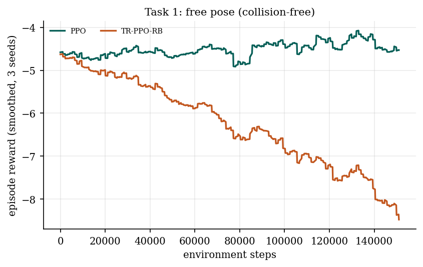
*Task 1 learning curves (smoothed episode reward, 3 seeds)*

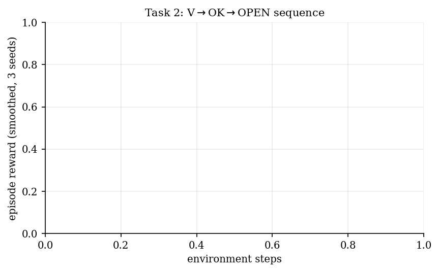
*Task 2 learning curves*

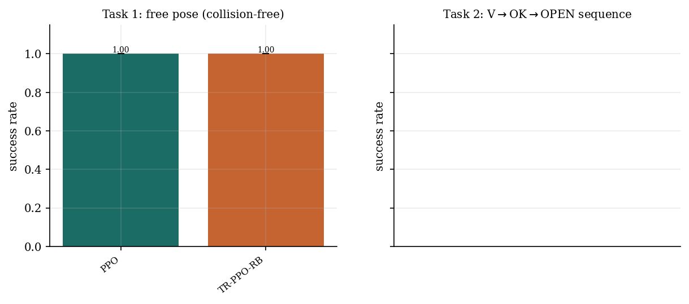
*Final success rate (deterministic 25-seed eval, mean±σ)*

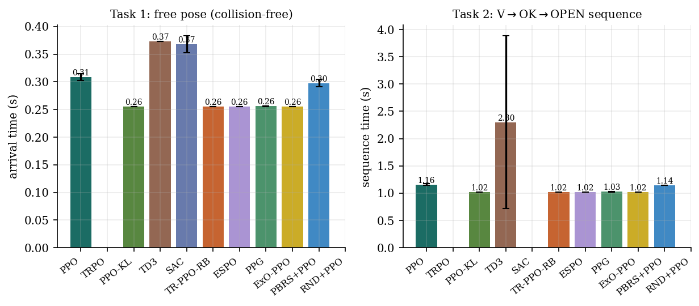
*Arrival / sequence time*

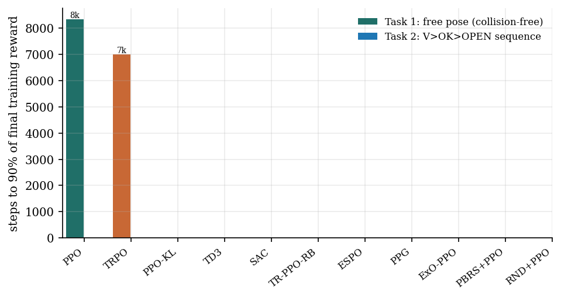
*Sample efficiency: steps to 90% of final training reward*

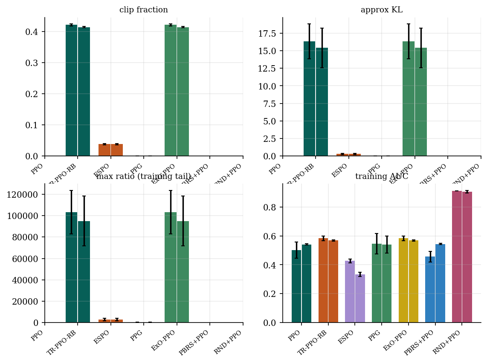
*PPO-family optimizer diagnostics (clip/KL/ratio/AUC)*

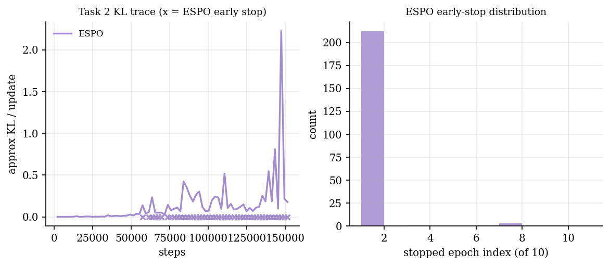
*ESPO early stopping: KL trace + stop-epoch histogram*

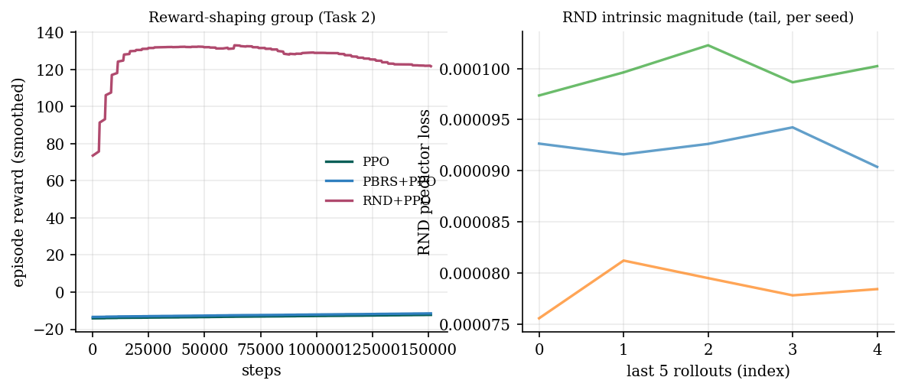
*Reward-shaping group (PBRS/RND vs PPO) + RND intrinsic tail*

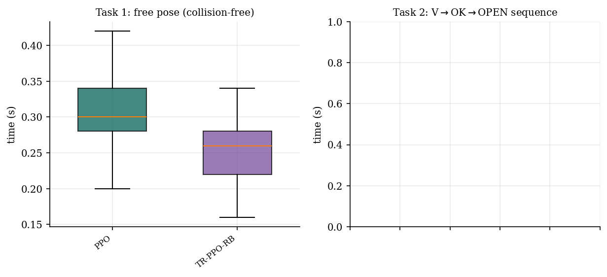
*Evaluation time distributions (box plots)*

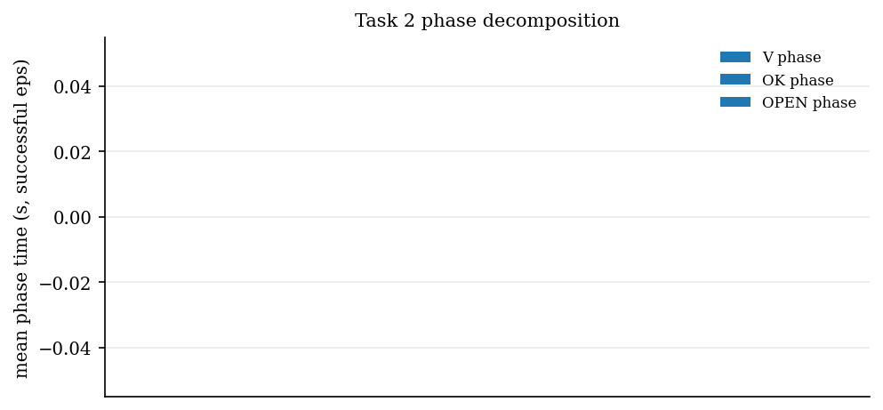
*Task-2 per-phase time decomposition (V/OK/OPEN)*

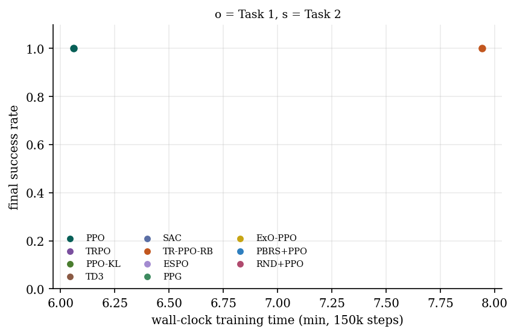
*Wall-clock efficiency: final success vs training time*

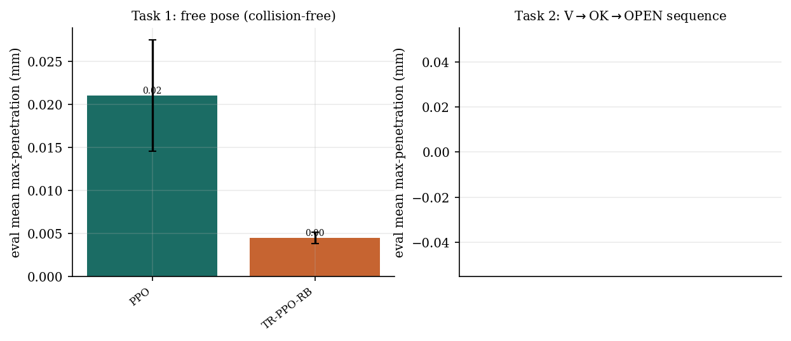
*Safety proxy: max self-penetration during evaluation*

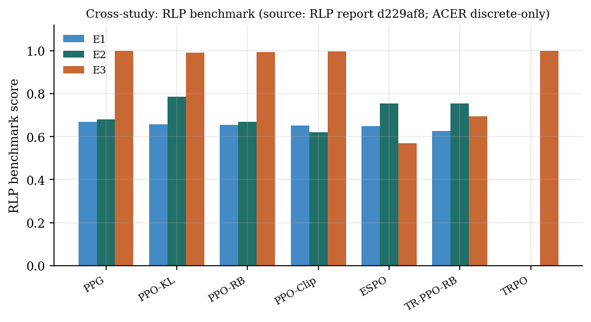
*Cross-study comparison (RLP benchmark, static data)*

## Experimental Protocol
- **Matrix**: 2 tasks × 11 methods × 3 seeds = 66 runs, 150 000 environment steps each.
- **Shared backbone**: residual action `cmd = prior + 0.3·π(s)` with 0.15 rad/cycle rate limit; the zero policy is a solvable direct baseline, so all methods optimize the same correct prior.
- **Networks**: 256×256 for every method (PPG uses a shared trunk by construction).
- **Evaluation**: deterministic policy, 25 fixed seeds (7001–7025) per run; success, arrival/sequence time and self-penetration are hard metrics.
- **Stack**: MuJoCo 3.3.7 · torch 2.11.0+cu130 · Stable-Baselines3 2.9.2 · RTX 3070 Laptop.
- **Training curves use episode reward**: sampled-noise rollouts structurally record ~0 training-time successes (hold-window criterion), a known artifact documented in the report.

## Disclosed Deviations from Original Papers
1. **TR-PPO-RB**: per-state KL is proxied by |log ρ| > 0.5 (SB3 does not store old distribution parameters); rollback coefficient c = (1+ε)/(1−ε) = 1.5.
2. **RND**: single value head (paper uses separate value heads + non-episodic intrinsic returns); intrinsic weight 0.5 with running normalization.
3. **ExO-PPO**: smooth compression implemented as ε·tanh saturation of log-ratio beyond the trust region.
4. **OPPO**: cited only (LLM serving-overlap systems paper; no inference loop in this robot study).
5. PBRS shaping adds no terminal-potential correction on time-limit truncation (success terminates at Φ≈0).
6. **TD3/SAC cadence**: gradient updates every 4 env steps in batches of 4 (update-to-data ratio 1:1, identical to the papers; the batching is a wall-clock optimization on a single laptop GPU).
7. **TD3/SAC device**: mixed by measurement — free TD3 s2/s3 and SAC s1/s3+seq ran on GPU; SAC s2 ran on CPU (WSL thread contention made CPU slower: 3h+ vs 2h04m GPU). Updates are mathematically equivalent; devices are recorded per-run in config.json.
8. **RND module device**: forced to CPU after per-child CUDA contexts deadlocked inside SubprocVecEnv workers (two consecutive seq hangs); free-task RND runs completed on the GPU module before the fix — values are numerically equivalent.
9. **RND vec-env backend**: after four consecutive seq-task pipe deadlocks, RND runs use DummyVecEnv (8 envs stepped in one process). Rollout semantics (n_steps per env, batch sizes) are bit-identical; only stepping is sequential.

## Cross-study context (RLP benchmark)

| Method | E1 | E2 | E3 | Note |
|---|---|---|---|---|
| PPG | 0.669±0.02 | 0.681 | 1.000±0.00 |  |
| PPO-KL | 0.658 | 0.785 | 0.992 |  |
| PPO-RB | 0.655 | 0.669 | 0.995 |  |
| PPO-Clip | 0.652 | 0.620 | 0.996 | E2 种子散布 ±0.17 |
| ESPO | 0.648 | 0.755 | 0.568 |  |
| TR-PPO-RB | 0.625 | 0.754 | 0.694 |  |
| TRPO | -- | -- | 1.000 | E3=1.000 真值；CG+线搜开销 |
| ACER | -- | -- | -- | 离散动作对照（SB3 ACER 仅支持离散，详见 RLP 报告） |

*Source: Reinforcement-Learning-Policy 仓实验报告（11 页，d229af8）*

## Quick Start
```bash
git clone https://github.com/aitachi/Aitachi-Hand && cd Aitachi-Hands
python scripts/fetch_assets.py          # official orca_v2 model (not committed)
bash scripts/smoke_all.sh               # 13-path smoke (~4 min)
bash scripts/run_matrix_all.sh          # full 66-run matrix (~6-8 h, RTX 3070)
python scripts/aggregate.py             # results/summary.{csv,json}
python scripts/make_figures.py          # figures/fig01..fig12
python scripts/gen_results_snippet.py   # refresh IEEE paper numbers
python scripts/gen_readme.py            # refresh this README
```

> The 111 MB MuJoCo model is not committed — run `python scripts/fetch_assets.py` (or set `AHAND_MODEL_ROOT` to an existing orca_v2 copy).

## Limitations
Simulation-scoped results; deployment requires the separate guarded replay pipeline (rate-limited segments, current/temperature/voltage/stall protection, camera correction). One fixed budget — per-method tuning could reorder rankings; this is a *controlled* comparison.

## Deliverables
- 📕 Textbook (19-page PDF, Chinese): `textbook/main.pdf`
- 📄 IEEE paper: `paper/ieee_main.pdf` (results auto-generated from `results/summary.json`)
- 📊 12 comparison figures: `figures/`
- 🧾 Servo command appendix: textbook Appendix A / `docs/`
- 🌐 Project site: http://115.190.62.87/Aitachi-Hand/

