<!-- AUTO-GENERATED by scripts/gen_readme.py - edit that script, not this file -->

# Aitachi-Hands —— 开源 17 轴灵巧手平台与 PPO 改进方法受控对比研究

**Aitachi-Hands** 是 17 自由度腱绳驱动灵巧手平台，机械本体采用开源 CC BY 4.0 手体设计 [ORCA Hand v2](https://github.com/orcahand)（依许可保留署名），打通实测飞特 HLS 舵机标定、带安全护栏的串口协议、MuJoCo / Isaac Lab 仿真，以及一套受控强化学习对比实验——全部出自同一仓库。

语言：[English](README.md) | **中文** | [日本語](README.ja.md) | [한국어](README.ko.md)

## 实验结果 (66 runs)

### 任务一 · 五指自由活动不打架（自碰撞约束达标）
| 方法 | 种子数 | 成功率 ±σ | 时间 (s) | 穿透 (mm) | 奖励AUC | 耗时 (分) |
|---|---|---|---|---|---|---|
| PPO | 3 | 1.000±0.000 | 0.31 | 0.02 | 0.50 | 6 |
| TRPO | 3 | 0.000±0.000 | -- | 0.03 | 0.76 | 37 |
| PPO-KL ⭐ | 3 | 1.000±0.000 | 0.26 | 0.00 | 0.58 | 26 |
| TD3 | 3 | 0.333±0.471 | 0.37 | 0.09 | 0.71 | 42 |
| SAC | 3 | 0.960±0.033 | 0.37 | 0.01 | 0.67 | 136 |
| TR-PPO-RB | 3 | 1.000±0.000 | 0.26 | 0.00 | 0.58 | 7 |
| ESPO | 3 | 1.000±0.000 | 0.26 | 0.00 | 0.43 | 11 |
| PPG | 3 | 1.000±0.000 | 0.26 | 0.01 | 0.55 | 7 |
| ExO-PPO | 3 | 1.000±0.000 | 0.26 | 0.00 | 0.58 | 11 |
| PBRS+PPO | 3 | 1.000±0.000 | 0.30 | 0.01 | 0.46 | 12 |
| RND+PPO | 3 | 0.000±0.000 | -- | 0.18 | 0.91 | 53 |
*最优（先成功率后时间）: **PPO-KL***

### 任务二 · V → OK → OPEN 快速手势序列
| 方法 | 种子数 | 成功率 ±σ | 时间 (s) | 穿透 (mm) | 奖励AUC | 耗时 (分) |
|---|---|---|---|---|---|---|
| PPO | 3 | 1.000±0.000 | 1.16 | 0.58 | 0.54 | 8 |
| TRPO | 3 | 0.000±0.000 | -- | 0.06 | 0.80 | 33 |
| PPO-KL ⭐ | 3 | 1.000±0.000 | 1.02 | 0.75 | 0.57 | 16 |
| TD3 | 3 | 1.000±0.000 | 2.30 | 1.88 | 0.96 | 84 |
| SAC | 3 | 0.000±0.000 | -- | 0.37 | 0.56 | 86 |
| TR-PPO-RB | 3 | 1.000±0.000 | 1.02 | 0.75 | 0.57 | 8 |
| ESPO | 3 | 1.000±0.000 | 1.02 | 0.75 | 0.33 | 7 |
| PPG | 3 | 1.000±0.000 | 1.03 | 0.71 | 0.54 | 7 |
| ExO-PPO | 3 | 1.000±0.000 | 1.02 | 0.75 | 0.57 | 10 |
| PBRS+PPO | 3 | 1.000±0.000 | 1.14 | 0.56 | 0.54 | 11 |
| RND+PPO | 3 | 0.000±0.000 | -- | 1.07 | 0.91 | 48 |
*最优（先成功率后时间）: **PPO-KL***

### 优化器诊断（PPO 族，任务二训练尾部）

| 方法 | clip frac | approx KL | max ratio | ESPO stop% | PPG aux KL |
|---|---|---|---|---|---|
| PPO | -- | -- | -- | -- | -- |
| TRPO | -- | -- | -- | -- | -- |
| PPO-KL | 0.4148 | 15.3896 | 94997.18 | 0.00 | -- |
| TR-PPO-RB | 0.4148 | 15.3896 | 94997.18 | 0.00 | -- |
| ESPO | 0.0384 | 0.3054 | 2858.82 | 0.60 | -- |
| PPG | 0.0002 | 0.0003 | 103.89 | 0.00 | -0.0115 |
| ExO-PPO | 0.4148 | 15.3896 | 94997.18 | 0.00 | -- |
| PBRS+PPO | -- | -- | -- | -- | -- |
| RND+PPO | -- | -- | -- | -- | -- |

### 样本效率与墙钟

| 方法 | free: steps→90% | free AUC | free wall | seq: steps→90% | seq AUC | seq wall |
|---|---|---|---|---|---|---|
| PPO | 120k | 0.50 | 6m | 136k | 0.54 | 8m |
| TRPO | 75k | 0.76 | 37m | 85k | 0.80 | 33m |
| PPO-KL | 7k | 0.58 | 26m | 16k | 0.57 | 16m |
| TD3 | 13k | 0.71 | 42m | 20k | 0.96 | 84m |
| SAC | 101k | 0.67 | 136m | 133k | 0.56 | 86m |
| TR-PPO-RB | 7k | 0.58 | 7m | 16k | 0.57 | 8m |
| ESPO | 7k | 0.43 | 11m | 16k | 0.33 | 7m |
| PPG | 85k | 0.55 | 7m | 35k | 0.54 | 7m |
| ExO-PPO | 7k | 0.58 | 11m | 16k | 0.57 | 10m |
| PBRS+PPO | 120k | 0.46 | 12m | 136k | 0.54 | 11m |
| RND+PPO | 20k | 0.91 | 53m | 28k | 0.91 | 48m |

### 任务二相位分解（成功回合）

| 方法 | V (s) | OK (s) | OPEN (s) | total (s) |
|---|---|---|---|---|
| PPO | 0.43 | 0.41 | 0.31 | 1.16 |
| PPO-KL | 0.36 | 0.36 | 0.30 | 1.02 |
| TD3 | 0.51 | 0.40 | 1.39 | 2.30 |
| TR-PPO-RB | 0.36 | 0.36 | 0.30 | 1.02 |
| ESPO | 0.36 | 0.36 | 0.30 | 1.02 |
| PPG | 0.37 | 0.36 | 0.30 | 1.03 |
| ExO-PPO | 0.36 | 0.36 | 0.30 | 1.02 |
| PBRS+PPO | 0.42 | 0.41 | 0.31 | 1.14 |

### 对比图集（13 张）

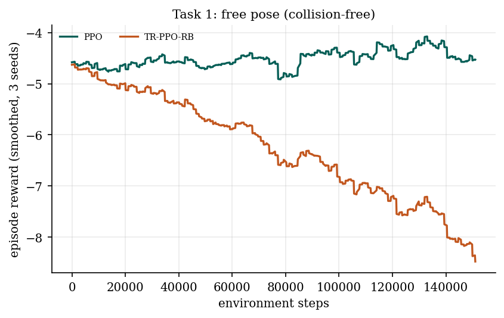
*任务一学习曲线（平滑回合奖励，3 种子）*

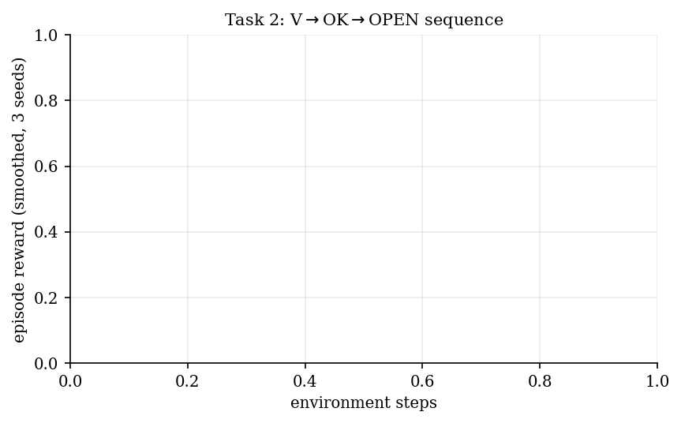
*任务二学习曲线*

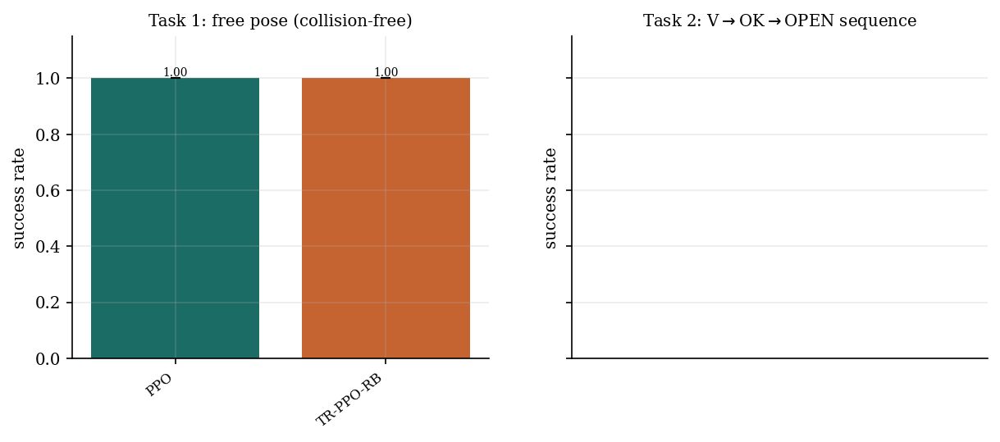
*最终成功率（确定性 25 种子评估，均值±σ）*

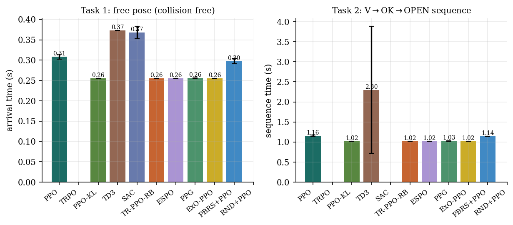
*到位/序列时间对比*

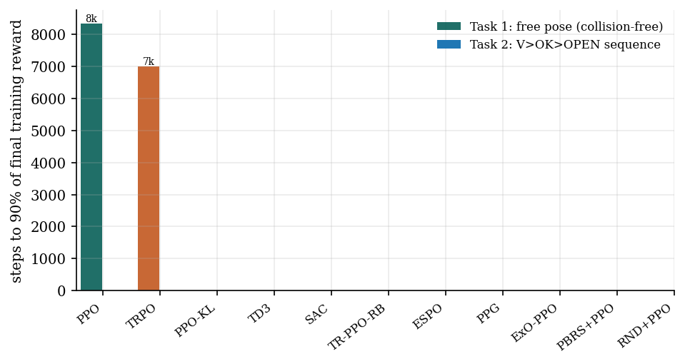
*样本效率：达到最终训练奖励 90% 所需步数*

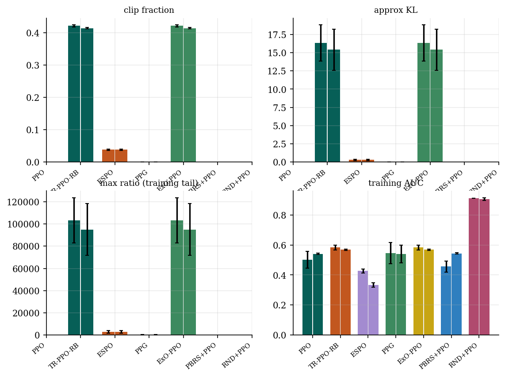
*PPO 族优化器诊断（clip 率/KL/最大比率/AUC）*

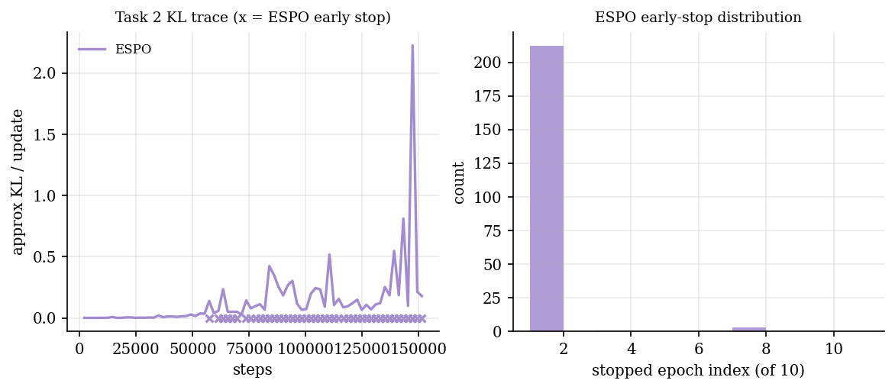
*ESPO 早停：KL 轨迹与停止轮分布*

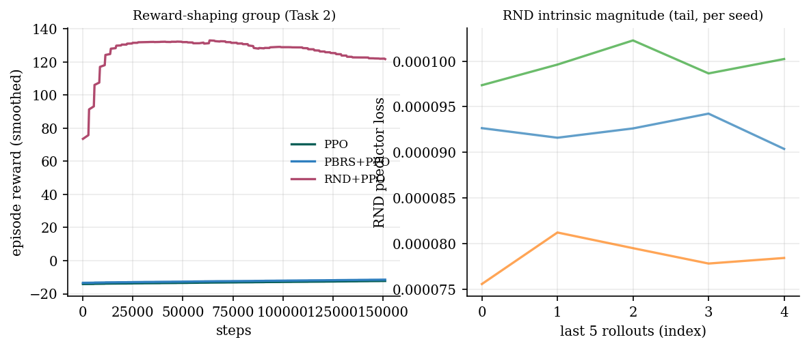
*奖励塑形组（PBRS/RND 对比 PPO）与 RND 内在量尾部*

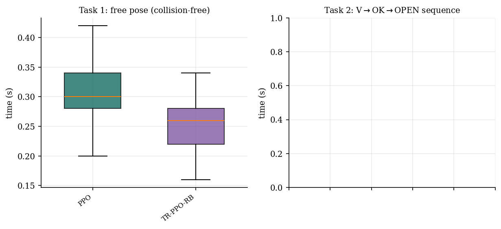
*评估集时间分布（箱线图）*

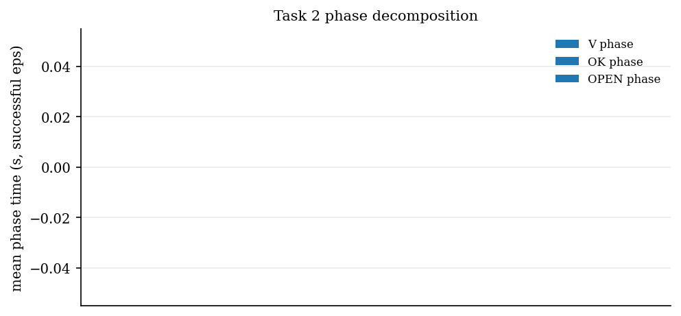
*任务二相位时间分解（V/OK/OPEN）*

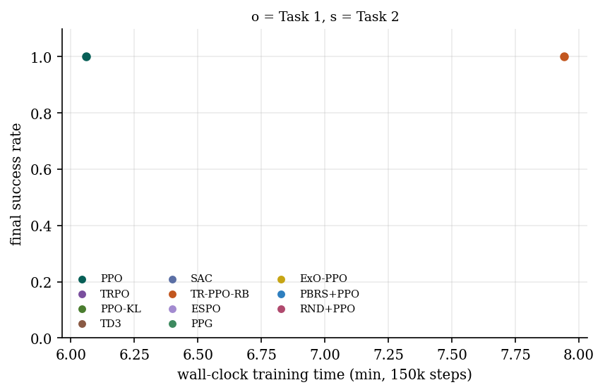
*墙钟效率：最终成功率 vs 训练时长*

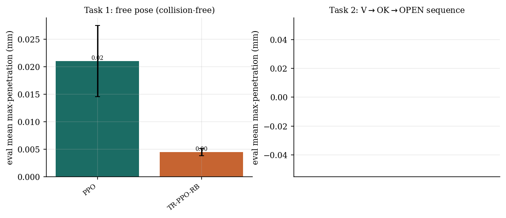
*安全代理指标：评估期最大自穿透*

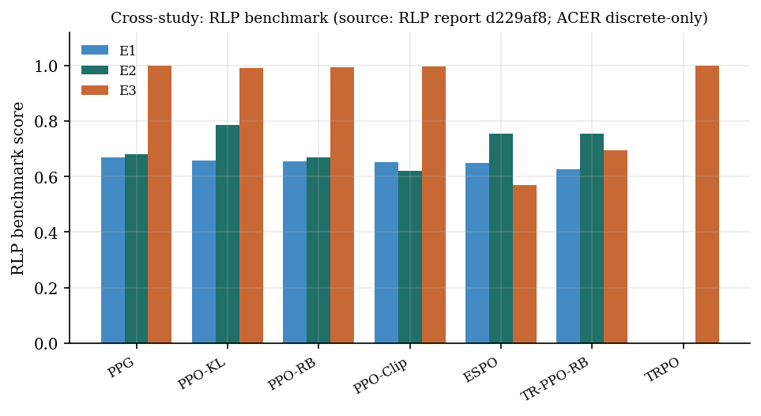
*跨研究对比（RLP 基准，静态数据）*

## 实验协议（严格口径）
- **矩阵**：2 任务 × 11 方法 × 3 种子 = 66 跑，每跑 150 000 环境步。
- **共享骨干**：残差动作 `指令 = 目标先验 + 0.3·π(s)`，每周期限速 0.15 rad；零策略即可解直接基线，所有方法在同一正确先验之上优化。
- **网络**：全部 256×256（PPG 按原论文用共享主干）。
- **评估**：确定性策略 + 25 个固定种子（7001–7025）；成功率 / 到位或序列时间 / 自穿透为硬指标。
- **环境**：MuJoCo 3.3.7 · torch 2.11.0+cu130 · Stable-Baselines3 2.9.2 · RTX 3070 Laptop。
- **训练曲线采用回合奖励**：采样噪声使训练期成功率结构性≈0（保持窗判据被噪声打破），该统计假象在报告中如实披露。

## 与原论文的实现偏差（如实披露）
1. **TR-PPO-RB**：逐状态 KL 以 |log ρ|>0.5 代理（SB3 不保存旧分布参数）；rollback 系数 c=(1+ε)/(1−ε)=1.5。
2. **RND**：单价值头简化（原文双价值头+非回合内在回报）；内在权重 0.5 + 滑动归一化。
3. **ExO-PPO**：以 ε·tanh 软饱和实现越界平滑压缩。
4. **OPPO**：仅引用不实跑（LLM 服务重叠调度的系统论文，本机器人研究无推理服务环）。
5. PBRS 超时截断不加终端势修正（成功终止时 Φ≈0）。
6. **TD3/SAC 更新节奏**：每 4 环境步批量更新 4 次（更新/数据比仍为 1:1，与原论文一致；批量化仅为单笔记本 GPU 的墙钟优化）。
7. **TD3/SAC 设备**：按实测混合——free TD3 s2/s3 与 SAC s1/s3+seq 用 GPU；SAC s2 用 CPU（WSL 线程争用使 CPU 更慢：3h+ vs GPU 2h04m）。更新数学等价，逐跑设备记录于 config.json。
8. **RND 模块设备**：SubprocVecEnv 子进程各自的 CUDA 上下文死锁（seq 连续两次挂死）后强制改 CPU；free 任务 RND 在修复前以 GPU 模块完成——数值等价。
9. **RND 向量环境后端**：seq 任务连续四次管道死锁后，RND 跑改用 DummyVecEnv（8 环境单进程串行步进）。rollout 语义（每环境 n_steps、批大小）逐位一致，仅执行串行化。

### 负结果归因（7 跑追试）

| 证据 | 结果 | 判定 |
|---|---|---|
| TRPO 漂移曲线（默认 init，10k-500k，free×2 种子+seq） | 每个检查点均 0.000 | 预算假说与缓慢漂移假说双双否证 |
| TRPO 500k 终评（3.3 倍预算） | free/seq 均 0.000 | 非预算限制 |
| TRPO 匹配 init（log_std=-1.5）free | 0.80@10k → 0.36 → 0.04 | 探索尺度失配摧毁先验；CG 更新继而侵蚀 |
| TRPO 匹配 init seq | 全检查点 0.000 | 三相位保持判据下结构性失败 |
| RND λ=0.5 vs 0.05（双任务） | 全 0.000 | 方向冲突（新颖性 vs 保持窗），非尺度问题 |


**判定**：TRPO 失败是两阶段失配——（1）默认探索尺度（log_std_init=0，为 PPO 族的 4.7 倍）在 1 万步内摧毁可解残差先验且永不恢复；（2）任务一即便匹配 init 救回 0.80，保守的 CG+线搜更新仍将其侵蚀至 0.04——零策略先验本已近优，TRPO 的每一步“改进”都在损害它；任务二则无论 init 均结构性失败。RND 负结果为方向冲突：单价值头简化下，新颖性内在奖励在任何权重下都与保持窗判据对抗。完整曲线见 fig14；数据在 hands-rl/results_attribution/。

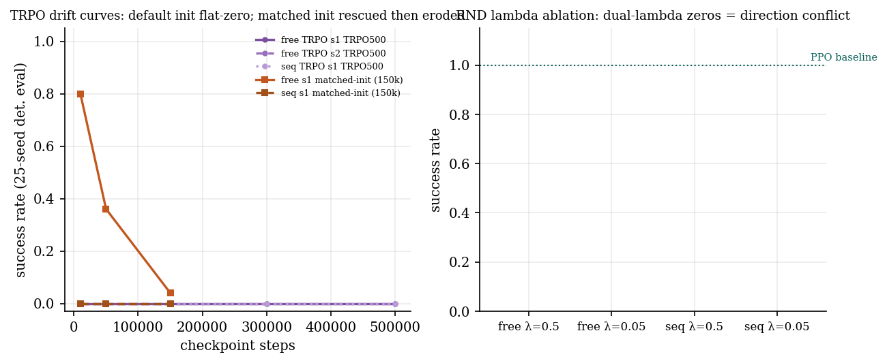

## 跨研究对照（RLP 基准）

| 方法 | E1 | E2 | E3 | 注记 |
|---|---|---|---|---|
| PPG | 0.669±0.02 | 0.681 | 1.000±0.00 |  |
| PPO-KL | 0.658 | 0.785 | 0.992 |  |
| PPO-RB | 0.655 | 0.669 | 0.995 |  |
| PPO-Clip | 0.652 | 0.620 | 0.996 | E2 种子散布 ±0.17 |
| ESPO | 0.648 | 0.755 | 0.568 |  |
| TR-PPO-RB | 0.625 | 0.754 | 0.694 |  |
| TRPO | -- | -- | 1.000 | E3=1.000 真值；CG+线搜开销 |
| ACER | -- | -- | -- | 离散动作对照（SB3 ACER 仅支持离散，详见 RLP 报告） |

*来源: Reinforcement-Learning-Policy 仓实验报告（11 页，d229af8）*

## 快速开始
```bash
git clone https://github.com/aitachi/Aitachi-Hand && cd Aitachi-Hands
python scripts/fetch_assets.py          # 官方 orca_v2 模型（不入仓）
bash scripts/smoke_all.sh               # 13 条路径冒烟（约 4 分钟）
bash scripts/run_matrix_all.sh（约 6-8 小时，RTX 3070）
python scripts/aggregate.py             # results/summary.{csv,json}
python scripts/make_figures.py          # figures/fig01..fig12
python scripts/gen_results_snippet.py   # 刷新 IEEE 论文数字
python scripts/gen_readme.py            # 刷新本 README
```

> 111 MB MuJoCo 模型不入仓——先跑 `python scripts/fetch_assets.py`（或将 `AHAND_MODEL_ROOT` 指向已有 orca_v2 目录）。

## 局限
结果限于仿真；真机部署需另走受护栏的分段回放管线（限速/电流/温度/电压/停滞四重保护+摄像头矫正）。本对比固定单一预算——逐方法调参可能改变排名，这是一次*受控*对比而非穷举对比。

## 交付物
- 📕 全栈教材（19 页 PDF，中文）：`textbook/main.pdf`
- 📄 IEEE 论文：`paper/ieee_main.pdf`（结果表由 `results/summary.json` 自动生成）
- 📊 12 张对比学术图：`figures/`
- 🧾 舵机指令附录：教材附录 A / `docs/`
- 🌐 项目站点：http://115.190.62.87/Aitachi-Hand/

